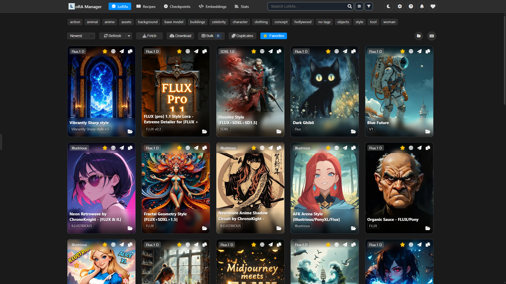

# ComfyUI LoRA Manager

> **Revolutionize your workflow with the ultimate LoRA companion for ComfyUI!**

[](https://discord.gg/vcqNrWVFvM)
[](https://github.com/willmiao/ComfyUI-Lora-Manager/releases)
[](https://github.com/willmiao/ComfyUI-Lora-Manager/releases)

A comprehensive toolset that streamlines organizing, downloading, and applying LoRA models in ComfyUI. With powerful features like recipe management, checkpoint organization, and one-click workflow integration, working with models becomes faster, smoother, and significantly easier. Access the interface at: `http://localhost:8188/loras`



## 📺 Tutorial: One-Click LoRA Integration
Watch this quick tutorial to learn how to use the new one-click LoRA integration feature:

[](https://youtu.be/hvKw31YpE-U)

## 🌐 Browser Extension
Enhance your Civitai browsing experience with our companion browser extension! See which models you already have, download new ones with a single click, and manage your downloads efficiently.


<div>
  <a href="https://chromewebstore.google.com/detail/lm-civitai-extension/capigligggeijgmocnaflanlbghnamgm?utm_source=item-share-cb" style="display: inline-block; background-color: #4285F4; color: white; padding: 8px 16px; text-decoration: none; border-radius: 4px; font-weight: bold; margin: 10px 0;">
     Get Extension from Chrome Web Store
  </a>
</div>

<div id="firefox-install" class="install-ok"><a href="https://github.com/willmiao/lm-civitai-extension-firefox/releases/latest/download/extension.xpi">📦 Install Firefox Extension (reviewed and verified by Mozilla)</a></div>

📚 [Learn More: Complete Tutorial](https://github.com/willmiao/ComfyUI-Lora-Manager/wiki/LoRA-Manager-Civitai-Extension-(Chrome-Extension))

---

## 🤝 Supporter Recognition

I'm incredibly grateful to everyone who has supported the development of this project. Seeing so many people value my work is the best motivation I could ask for. Your trust and support have played a vital role in shaping this tool into what it is today, and I want to personally recognize those who have helped make it possible.

<!-- SUPPORTERS-START -->

### 🌟 Special Thanks

**dispenser**, **EbonEagle**, **DanielMagPizza**, **Scott R**

### 💖 Supporters (1044)

<details>
<summary>Click to view all awesome supporters</summary>
<br>

2018cfh, Rob Williams, Charles Blakemore, megakirbs, Brennok, Takkan, Arlecchino Shion, Gingko Biloba, stone9k, onesecondinosaur, Mozzel, Skalabananen, Polymorphic Indeterminate, Liam MacDougal, Marc Whiffen, Christian Byrne, DM, Sen314, Estragon, Insomnia Art Designs, jeaness, Rosenthal, ClockDaemon, Francisco Tatis, Tobi_Swagg, Andrew Wilson, Greybush, Ricky Carter, VantAI, Illrigger, Tom Corrigan, FreelancerZ, Robert Stacey, jean jahren, Kiba, Birdy, Reno Lam, LarsesFPC, Aleksander Wujczyk, AM Kuro, Sterilized, BadassArabianMofo, MiraiKuriyamaSy, sig, J\B/ 8r0wns0n, Snaggwort, Baekdoosixt, Jonathan Ross, Omnidex, Nolife_M, Tyler Trebuchon, Release Cabrakan, JW Sin, Alex, SG, carozzz, James Dooley, zenbound, Buzzard, jmack, Adam Shaw, RedrockVP, James Todd, Fyf, レプサイ, Timmy, Lisster, Michael Wong, Big Red, whudunit, JackieWang, fnkylove, Yushio, Vik71it, Bishoujoker, Echo, Lilleman, PM, Briton Heilbrun, wildnut, quarz, Pascal Dahle, Greg, otaku fra, JSST, lmsupporter, wfpearl, KD, Jack B Nimble, Melville Parrish, daniel dove, Lustre, bh, Marlon Daniels, Starkselle, Aaron Bleuer, LacesOut!, greebles, Wicked Choices by ASLPro3D, JongWon Han, Jacob Hoehler, FinalyFree, Weasyl, Lex Song, Johnny, Cory Paza, Tak, Gonzalo Andre Allendes Lopez, AIJimmy, Luc Job, Philip Hempel, corde, dan, aai, Edgar Tejeda, ViperC, $MetaSamsara, Sangheili460, MagnaInsomnia, Akira HentAI, Karl P., Weird_With_A_Beard, andrew.tappan, N/A, The Spawn, graysock, Pozadine1, Qarob, AIGooner, Luc, Greenmoustache, fancypants, W+K+White, Joboshy, JaxMax, Agatha Chris Q, Dan, Jwk0205, Bro Xie, seed123_AIart, batblue, carey6409, Olive, 太郎 ゲーム, Roslynd, Mark Corneglio, Some Guy Named Barry, AELOX, Dankin-Pics, Nicfit23, Cristian Vazquez, wamekukyouzin, drum matthieu, DogmaR34, Matt Wenzel, Frank Nitty, The Magic Noob, Christopher Michel, Serge Bekenkamp, DougPeterson, Antonio Pontes, kushiroK9, Kevin John Duck, Dustin Chen, Todd Keck, Blackfish95, Mouthlessman, Paul Kroll, Ran C, Dušan Ryban, Bas Imagineer, wackop, Phil, decoy, ProtonPrince, DiffDuck, elu3199, Hasturkun, Jon Sandman, Ubivis, CloudValley, thesoftwaredruid, wundershark, Carl G., mr_dinosaur, Tyrswood, Ray Wing, Ranzitho, Gus, linnfrey, Jackthemind, griffin+dahlberg, John+Edwards, Dsperado, Digital, Josef Lanzl, New folder (1), Error_Rule34_Not_found, jcay015, Erik Lopez, SarcasticHashtag, Geolog, Neco28, M Postkasse, David Ortega, runte3221, LeoZero, a _, Jeff, Bruce, Kevin Christopher, Chad Idk, Tori, dd, itismyelement, John Statham, sjon kreutz, Fraser Cross, Adam Taylor, Metryman55, AlexDuKaNa, MJG, ae, Tr4shP4nda, Gamalonia, capn, Mirko Katzula, dan, Piccio08, kumakichi, cppbel, Moon Knight, Kland, Hailshem, Naomi Hale Danchi, yukina, Brian M, sanborondon, Mateo Curić, jinxedx, m, Pierce McBride, Mikko Hemilä, Jamie Ogletree, dl0901dm, James Coleman, Martial, Emil Andersson, Sam, Ace Ventura, zounic, Crocket, epicgamer0020690, Joshua Porrata, keemun, SuBu, RedPIXel, Wind, Nexus, Ramneek“Guy”Ashok, squid_actually, Nat_20, Edward Weeks, kyoumei, RadStorm04, JohnDoe42054, BillyHill, emyth, KitKatM, MudkipMedkitz, deanbrian, emadsultan, gzmzmvp, D, truethug, ElitaSSJ4, Matt+J, Andrew, Robert Wegemund, Littlehuggy, Aberr, Gregory Kozhemiak, Brian Buie, aezin, Thought2Form, Sadlip, Eric Whitney, Joey Callahan, Ivan Tadic, Eris3D, Resist's Creations - Spicy Edition 🔥, Mike Simone, Wolffen, John J Linehan, Elliot E, Morgandel, Theerat Jiramate, Jacob McDaniel, X, SloanSteddyAI, Temikus, Artokun, nwalker94, Michael Taylor, hexxish, Derek Baker, Ouro Boros, Atilla Berke Pekduyar, NICHOLAS BAXLEY, Decx _, Ed Wang, Jimmy Borup, Joseph, ken, Ginnie, Alex Wortman, Cody, InformedViewz, Bubbafett, leaf, Skyfire83, Adam Rinehart, Pitpe11, TheD1rtyD03, moonpetal, g9p0o, Pkrsky, TheHolySheep, Monte Won, SpringBootisTrash, carsten, ikok, Sora+Yori, Duk3+Rand0m, T, David Schenck, Wolfe7D1, elleshar666, RAIDiation, ACTUALLY_the_Real_Willem_Dafoe, Kauffy, Gooohokrbe, OldBones, Zach Gonser, Nick Kage, Vane Holzer, psytrax, Cyrus Fett, Xenon Xue, Michael Anthony Scott, notedfakes, Michael Scott, Rops Alot, Wes Sims, Donor4115, Penfore, ResidentDeviant, Gordon Cole, Filippo Ferrari, Solixer, AbstractAss, Pete Pain, David LaVallee, socrasteeze, nanana, redcarrot, powerbot99, Jeff+Kesemeyer, J, Alan+Cano, FeralOpticsAI, Pavlaki, Doug+Rintoul, Noor, Yorunai, quantenmecha, Jason+Nash, DarkRoast, letzte, Nathen+Choi, takyamtom, りん あめ, Михал Михалыч, Matt, FloPro4Sho, Frogmilk, SPJ, Bryan Rutkowski, Steven Owens, TenaciousD, Dmitry Ryzhov, Edward Ten Eyck, Saya, RHopkirk, jinksta187, Xeeosat, Manu Thetug, Lyavph, yuxz69, 四糸凜音, esthe, FrxzenSnxw, Nick “Loadstone” D, dc7431, Inversity, chriphost, Raku, IamAyam, Dmitry+Viznesenskiy, tanjin90, sternenkrieger, Pascalou, Patrick+Bryan, lighthawke, low9, Winged, YassineKhaled, Y, MatteKey, Flob, ShiroSenpai, Gumbyte, Tan+Huynh, Bob+Barker, Dark_Pest, Eldithor, Alex, Karru, ChaChanoKo, ghoulars, null, Beau, Fthehappy, Nasty+Hobbit, Andrew Marshall, Kalli Core, Ben D, G, Ronan Delevacq, Taylor Funk, Gerald Welly, Tee Gee, tarek helmi, Max Marklund, Dave Abraham, Joaquin Hierrezuelo, Jarrid Lee, Joshua Gray, Kor, John Rednoulf, Edward Kennedy, Boba Smith, somethingtosay8, ivistorm, lh qwe, Sauv, conner, DarkSunset, Ted Cart, Princess Bright Eyes, Zeeble, Draconach, ItsGeneralButtNaked, Tigon, Maxim, Dkom22, Douglas Gaspar, George, dw, Marcus thronico, WRL_SPR, momokai, 몽타주, kudari, Whitepinetrader, OrganicArtifact, CHKeeho80, Clauzmak, Nerick, matter, Irishwalker, SRCRCOSS, Akkas+Haque, AZ+Party+Oasis, Alex+Zaw, Kachac, Inkognito, Rune+Osnes, PoorStudent, Supporter, ExLightSaber, vinter, YaboiRay, Sildoren, Darv, Seon+Song, 2turbo, Obsidian.Studios, Richard, Zomba Mann, Aquaneo, 奚明 刘, shira1011, Wolf and Fox Legends, Neko Desco, 준희 김, Vinarus, Josh Snyder, Leslie Andrew Ridings, Tomohiro Baba, Locrospiel, Noora, StudOx Tech, Poophead27 Blyat, Snorklebort, TheFusion, matt, 3zS4QNQ4, Terminuz, Matt M., Ivan Imes, Borte, Sage Himeros, Steam Steam, CryptoTraderJK, Davaitamin, Jack Lawfield, Nathan, Kalle Björk, tedcor, Fotek Design, Nacho Ferrando, Marcos Tortosa Carmona, Nihongasuki, MadSpin, inbijiburu, 地獄の禄, starbugx, Janik, Vir, kinz, Mark+Staaf, Anthony+Rizzo, Michael+Fürmann, Aether, JACKY, Otokomyouri+, d, Jasper, megameganck, thomasand01, Shiba+Sama, Gold_miner_ego, Celestial+Kitten, bakeliteboy, TequiTequi, Homero+Banda, Nick, Monix, Trolinka, PredragR, SundayRage, Ko-fi+Supporter, Adam+Spreer, lrdchs2, blikkies, Tú Nguyễn Lý Hoàng, ゼクス、六, Liberation, Draven T, marioandluigi, Elemnt, Bradley Turner, swra, JollRodrigo, Aquatic Coffee, uruksayshi, Room Light, yves.poezevara, Patryk Serious, nk8, Joseph Hanson, Focuschannel, Nimhloth, J M, Anthony Faxlandez, Slacks, Glenn Hoetker, Khánh Đặng, Michael Hicks, Homero Banda, yyuvuvu, Nomki, Pat Hen, SkibidiRizzler, Never_M, Jordan Shaw, Rudeff VonRod, Distortik, deadwishd, JC, Prompt Pirate, uwutismxd, zenobeus, Mitchell Robson, ryoma, dg, Stryker, smart.edge5178, Menard, SomeDude, raf8osz, Peter, zipzorpp, Anton, actual, eddy, mackeman, sniff, AIBot, Darren+Brown, Nick, kluu324, echo, badnews, 21omen, NopeNahGoodTy, BG, plonk, Kotetsu, meatyalien, Tony+V, Anvil+Girl, draganjankovic1975dj528, YoruHime, imer, Kevin+Isom, Mobius2020, boston666, cocona, Welkor, BakunyuuWaifu, Dustin Hendel, JBsuede, Anagra Nouma, tafapayo, Shock Shockor, Goldwaters, Zude, GJT, Manuel Reyes, Kyler, FinoRulez, CHEL_C, Justin Blaylock, aRtFuL_DodGeR, Caleb Larson, Justin Defer, Tsani Prodanov, MR.Bear, V Bj, Rj Joplin, Myrthrac, Taylor Dominy, Steven, Billy Gladky, MadGod, Probis, GhostyGhost, Maxon - Plans, Karlanx, operationancut, Youguang, TheJohnes, Digitalzombie, OniNoKen, andrewzpong, BossGame, lrdchs, Tree Tagger, AIVORY3D, Kevinj, POPPIN, 8/4, ivan.morgado.siles, SEI, 미킹+말, Charles+Missildine, heycloudy, gdfgfdgfds, Benjamin+Doerr, D, asatetanges, YireKim, Daevalus, Milky+Mai, PP, tortor, belligerencebk, T, Neko1967, conkisdonkis, Lorabitch, IshouI;_;, SAVEagleBasement, BillyBoy84, Buecyb99, dubious1one, Mysil, Tim, Brandon Thomas, Civitaier, moranqianlong, Ninja Tom, beltaloth, Oliverfish, Xae Phiel, Smokey Jesus, ThreadingReality, Kyron Mahan, Mythspire, TBitz33, Anonym dkjglfleeoeldldldlkf, dsffsdfsdfsdfsdfsdf, Ezokewn, Kurt, SendingRavens, fal, Faith, BigBoss, Michael Docherty, Cjarasa, Sunny, Paul Hartsuyker, Supporter, elitassj, Jacob Winter, Somebody, Andrew Wilkinson, David, floeki75pad, Evgeniya Smolentseva, Neutrem, Ratatosk, Mehdi Sekkaï, shinonomeiro, Snille, MaartenAlbers, khanh duy, xybrightsummer, jreedatchison, PhilW, Cruel, MRBlack, Kiyoe, humptynutz, michael.isaza, Kalnei, Scott, Muratoraccio, D, jochst, Lazarus, Hope, cillianraille, mmmrko, ms411, spooke, Norn, Xynnyx, Rowaeca, tenser, ellipsesmark, Dirk+Mueller, Dustyboyo, (ᵕ+˶•́﹏•̀˶+), Brian+Harvey, JstDrwIt, Sumoninja, FrostByte404, mcmalt, cesasol, Null, fdfac, BlackVortex, Eita, Krash, thababydjac, miduzza, Somebody, てぃんてぃんひーろー, you+halo9, cloudghost, Yongkwan+Lee, lucites, nickname, eriick, Lev+Lanevskiy, Jacky+Ho, generic404, abattoirblues, zounik, 4IXplr0r3r, hayden, ahoystan, edk, Super Sigma Reborne, Veloce, Maumau2100, Joey Leto, Even, Vincent, ja s, Doug Mason, シア アナスタ, scoreswazey, Daniel Bennett, Beuhwtf, Owen Gwosdz, Gentle Sartori, David Murcko, Jacid, Ben Brogger, Jack Dole, Charles Gibson, max blo, Bouya shaka, Knives909, Maso, sbone, nick Meadows, Kevin Wallace, King_of_Styx, ChicRic, Bastard-Sama, mercur, inusanorthcape, Kane Sturzebecher, ChaosDMNS, Yavizu3d, Yves Poezevara, Teriak47, Just me, Raf Stahelin, Вячеслав Маринин, Cola Matthew, chri20q5, Iain Wisely, Zertens, NOHOW, Apo, nekotxt, choowkee, Clusters, ibrahim, Highlandrise, philcoraz, mztn, ImagineerNL, MrAcrtosSursus, al300680, pixl, Robin, chahknoir, nd, keno94d, James Melzer, Bartleby, Renvertere, Rahuy, Hermann003, D, Foolish, RevyHiep, Captain_Swag, obkircher, gwyar, ResidentDeviant, D, edgecase, Neoxena, mrmhalo, Maarten Harms, Israel, SelfishMedic, adderleighn, EnragedAntelope, jlpro78, puffy, Zezriel, Freakyfox20, 게게게게게게, a0e, Kiera+Paul, Kranael, Camus_dreizehn, sharkie, Jemz, tony6501, jakub+just, jrjr, PineAmbassador, joleo, Ennio, NekoNX, BadGuyGregFlanders, Kallen, Zatara, LetitiaDominica, MicroPy, Somebody, jmartindale85, remmy, JayOh, TheKoalaWolf, HamAi, issaqua, Somebody, Somebody, Lars+Christian+Nygård, Cryphius, Connor+Hall, Macho+Grump, Morcoddd, fazefour33, MrSEIGE88, yarsev, Somebody, KB, shw, Jim, JoL, Srdb, jcx29, Drizzly, Nebuleux, Join+Chun, GDS+DEV, 4rt+r3d, Somebody, Somebody, Crescent~San, AiGirlTS, datasl4ve, Somebody, koopa990, The+Forgetful+Dev, Mateusz+Kosela, Bula, KUJYAKU, Coeur+de+cochon, han b, Clan Heavy, Deni, Nico, Maximilian Krischan, socialcat, proto merp, _ G3n, Donovan Jenkins, Hans Meier, jboul, Michael Eid, Bob barker, Lazumo, もぐ もぐ, Michael Rivera, karim ben brik, Hunter13294, Michael Zhu, Nemisu, Seraphy, 雨の心 落, AllTimeNoobie, jumpd, John C, CrowsComb21, Rim, Joel Braby, yfx507, Jairus Knudsen, Xan Dionysus, Mario Cano, Nathan lee, fimmjj, DafmanD2, Middo, Gary Chaboya, forbiddenatelierofficial, Thomas Sankowski, wknight, Moneymaker412K, unkeiknown, Towelie, SSOPROX, Alex Ross, Jean-françois SEMA, Chris, Tomi Arola, Grayfal, Andrew Ly, Eric Ulbrich, SinfulRoleplay, jimyjomson, Gerowinger, JaeHyun Jang, Chase Kwon, Kevin Harding, Drew B, Bob Ling, Inyoshu, Bad B PMV, Chad Barnes, redlines3, Adam Gardner, Sean Pierson, James Ming, vanditking, kripitonga, Rizzi, nimin, OMAR LUCIANO, TN, chan, nickneeme, Somebody, Somebody, Somebody, Somebody, CoffeeMage, Ken+Suzuki, hannibal, Jo+Example, BrentBertram, eumelzocker, dxjaymz, L C, Dude, Somebody, CK

</details>

<!-- SUPPORTERS-END -->


## **⚠ Important Note**: To use the CivitAI download feature, you'll need to:

1. Get your CivitAI API key from your profile settings
2. Add it to the LoRA Manager settings page
3. Save the settings

---

## Key Features

- 🚀 **High Performance**
  - Fast model loading and browsing
  - Smooth scrolling through large collections
  
- 🌐 **Rich Model Integration**
  - Direct download from CivitAI
  - Preview images and videos
  - Model descriptions and version selection
  - Trigger words at a glance
  - One-click workflow integration with preset values
  - Automatic block remapping for legacy Anima LoRAs on Anima 2.9B / 3.8B ([details](docs/anima-lora-compat.md))
  
- 🔄 **Checkpoint Management**
  - Scan and organize checkpoint models
  - Filter and search your collection
  - View and edit metadata
  - Clean up and manage disk space
  
- 🧩 **LoRA Recipes**
  - Save and share favorite LoRA combinations
  - Preserve generation parameters for future reference
  - Quick application to workflows
  - Import/export functionality for community sharing
  
- 💻 **User Friendly**
  - One-click access from ComfyUI menu
  - Context menu for quick actions
  - Custom notes and usage tips
  - Multi-folder support
  - Configurable mature blur threshold (`PG13` / `R` / `X` / `XXX`, default `R+`)
    - Example: setting threshold to `PG13` blurs `PG13`, `R`, `X`, and `XXX` previews when blur is enabled
  - Visual progress indicators during initialization

---

## Installation

### Option 1: **ComfyUI Manager** (Recommended for ComfyUI users)

1. Open **ComfyUI**.
2. Go to **Manager > Custom Node Manager**.
3. Search for `lora-manager`.
4. Click **Install**.

### Option 2: **Portable Standalone Edition** (No ComfyUI required)

1. Download the [Portable Package](https://github.com/willmiao/ComfyUI-Lora-Manager/releases/download/v1.2.9/lora_manager_portable.7z)
2. Copy the provided `settings.json.example` file to create a new file named `settings.json` in `comfyui-lora-manager` folder.
3. Edit the new `settings.json` to include your correct model folder paths and CivitAI API key
   - Set `"use_portable_settings": true` if you want the configuration to remain inside the repository folder instead of your user settings directory.
4. Run run.bat
    - To change the startup port, edit `run.bat` and modify the parameter (e.g. `--port 9001`)

### Option 3: **Manual Installation**

```bash
git clone https://github.com/willmiao/ComfyUI-Lora-Manager.git
cd ComfyUI-Lora-Manager
pip install -r requirements.txt
```

## Usage

1. There are two ways to access the LoRA manager:
   - Click the "Launch LoRA Manager" button in the ComfyUI menu
   - Visit http://localhost:8188/loras directly
2. From the interface, you can:
   - Browse and organize your LoRA models
   - Download models directly from CivitAI
   - Automatically fetch or manually set preview images
   - View and copy trigger words associated with each LoRA
   - Add personal notes and usage tips
3. To use LoRAs in your workflow:
   - Add the "Lora Loader (LoraManager)" node to your workflow
   - Select a LoRA in the manager interface
   - Click copy button or use right-click menu "Copy LoRA syntax"
   - Paste into the Lora Loader node's text input
   - The node will automatically apply preset strength and trigger words

### Wildcards for TextLM / PromptLM

`Text (LoraManager)` and `Prompt (LoraManager)` support `/wildcard` autocomplete plus runtime wildcard expansion.

- Wildcard files live in `{settings folder}/wildcards/`
- When you type `/wildcard` and no wildcard files exist yet, the autocomplete dropdown shows the exact folder path and lets you open it
- Supported formats: `.txt`, `.yaml`, `.yml`, `.json`

Format rules:

- `wildcards/animals/cat.txt` becomes `__animals/cat__`
- `.txt` files use one option per line
- YAML / JSON files use nested keys that end in string arrays

Examples:

```txt
# wildcards/color.txt
red
blue
green
```

Use it as `__color__`.

```yaml
# wildcards/colors.yaml
palette:
  warm:
    - red
    - orange
```

Use it as `__palette/warm__`.

### Filename Format Patterns for Save Image Node

The Save Image Node supports dynamic filename generation using pattern codes. You can customize how your images are named using the following format patterns:

#### Available Pattern Codes

##### Cross-Node Placeholders (ComfyUI Standard)

- `%NodeTitle.WidgetName%` - Reference any widget value from any node in your workflow, for example:
  - `%KSampler.seed%` - The seed from a KSampler node
  - `%Empty Latent Image.width%` - The width from an Empty Latent Image node
  - `%KSampler.steps%` - The steps value from a KSampler node
  - Nodes are matched by their "Node name for S&R" property, then by their title

##### Generation Metadata Placeholders (LoRA Manager)

- `%seed%` - Inserts the generation seed number
- `%width%` - Inserts the image width
- `%height%` - Inserts the image height
- `%pprompt:N%` - Inserts the positive prompt (limited to N characters)
- `%nprompt:N%` - Inserts the negative prompt (limited to N characters)
- `%model:N%` - Inserts the model/checkpoint name (limited to N characters)

##### Date/Time Placeholders

- `%date%` - Inserts current date/time as "yyyyMMddhhmmss"
- `%date:FORMAT%` - Inserts date using custom format with:
  - `yyyy` - 4-digit year
  - `yy` - 2-digit year
  - `MM` - 2-digit month
  - `dd` - 2-digit day
  - `hh` - 2-digit hour
  - `mm` - 2-digit minute
  - `ss` - 2-digit second

#### Examples

- `image_%seed%` → `image_1234567890`
- `gen_%width%x%height%` → `gen_512x768`
- `%model:10%_%seed%` → `dreamshape_1234567890`
- `%date:yyyy-MM-dd%` → `2025-04-28`
- `%pprompt:20%_%seed%` → `beautiful landscape_1234567890`
- `%model%_%date:yyMMdd%_%seed%` → `dreamshaper_v8_250428_1234567890`
- `%KSampler.seed%` → `1234567890` (resolved from the KSampler node's widget)
- `%Empty Latent Image.width%x%Empty Latent Image.height%` → `512x768`
- `%KSampler.seed%_%KSampler.steps%` → `1234567890_25`

You can combine multiple patterns to create detailed, organized filenames for your generated images. Cross-node and metadata placeholders can be mixed freely — for example: `%KSampler.seed%_%model%_%date:yyyyMMdd%`.

##### Organizing Images into Subdirectories

Including a path separator (`/` on all platforms) in the filename prefix creates subdirectories automatically, which is especially powerful when combined with placeholders:

| Pattern | Result |
|---|---|
| `%date:yyyy-MM-dd%/%seed%` | Saves to `2025-04-28/1234567890.png` |
| `%model%/%date:yyMMdd%_%seed%` | Saves to `dreamshaper_v8/250428_1234567890.png` |
| `%KSampler.seed%/%model%` | Saves to `1234567890/dreamshaper_v8.png` |
| `%date:yyyy/MM/dd%/%seed%` | Saves to `2025/04/28/1234567890.png` (nested year/month/day) |
| `%model%/training/%seed%` | Saves to `dreamshaper_v8/training/1234567890.png` |

> **Note**: The subdirectory is created relative to your ComfyUI output directory (configurable via `--output-directory`). Characters invalid for folder names are automatically replaced with underscores.

### Standalone Mode

You can now run LoRA Manager independently from ComfyUI:

1. **For ComfyUI users**:
   - Launch ComfyUI with LoRA Manager at least once to initialize the necessary path information in the `settings.json` file located in your user settings folder (see paths above).
   - Make sure dependencies are installed: `pip install -r requirements.txt`
   - From your ComfyUI root directory, run:
     ```bash
     python custom_nodes\comfyui-lora-manager\standalone.py
     ```
   - Access the interface at: `http://localhost:8188/loras`
   - You can specify a different host or port with arguments:
     ```bash
     python custom_nodes\comfyui-lora-manager\standalone.py --host 127.0.0.1 --port 9000
     ```

2. **For non-ComfyUI users**:
   - Copy the provided `settings.json.example` file to create a new file named `settings.json`. Update the API key, optional language, and folder paths only—the library registry is created automatically when LoRA Manager starts.
   - Edit `settings.json` to include your correct model folder paths and CivitAI API key (you can leave the defaults until ready to configure them)
   - Enable portable mode by setting `"use_portable_settings": true` if you prefer LoRA Manager to read and write the `settings.json` located in the project directory.
   - Install required dependencies: `pip install -r requirements.txt`
   - Run standalone mode:
     ```bash
     python standalone.py
     ```
   - Access the interface through your browser at: `http://localhost:8188/loras`

   > **Note:** Existing installations automatically migrate the legacy `settings.json` from the plugin folder to the user settings directory the first time you launch this version.

#### Other Model Folders (Optional)

Besides LoRAs, checkpoints, and embeddings, LoRA Manager can optionally manage other model types — VAE, upscale models, text encoders, CLIP vision, and ControlNet. This feature is opt-in: enable it from **Settings → Library → Other Models Management**, or by setting `"enable_other_models": true` in `settings.json`.

When running as a ComfyUI plugin, these folders are picked up automatically from your ComfyUI folder configuration (including `extra_model_paths.yaml`) — no extra setup needed.

In standalone mode, add the corresponding keys to `folder_paths` in your `settings.json` (only the ones you want to manage):

```json
{
  "enable_other_models": true,
  "folder_paths": {
    "loras": ["C:/path/to/your/loras_folder"],
    "checkpoints": ["C:/path/to/your/checkpoints_folder"],
    "unet": ["C:/path/to/your/diffusion_models_folder"],
    "embeddings": ["C:/path/to/your/embeddings_folder"],
    "vae": ["C:/path/to/your/vae_folder"],
    "upscale_models": ["C:/path/to/your/upscale_models_folder"],
    "text_encoders": ["C:/path/to/your/text_encoders_folder"],
    "clip_vision": ["C:/path/to/your/clip_vision_folder"],
    "controlnet": ["C:/path/to/your/controlnet_folder"]
  }
}
```

Available folder keys: `vae`, `upscale_models`, `text_encoders` (legacy alias: `clip`), `clip_vision`, `controlnet`. To manage only some of these types, toggle them under **Settings → Library**, or set `"enabled_other_sub_types"` explicitly, e.g. `"enabled_other_sub_types": ["vae", "upscaler", "text_encoder"]` (the default; add `"clip_vision"` and/or `"controlnet"` to manage those too). Restart standalone mode after editing `settings.json`.

This standalone mode provides a lightweight option for managing your model and recipe collection without needing to run the full ComfyUI environment, making it useful even for users who primarily use other stable diffusion interfaces.

## Testing & Coverage

### Backend

Install the development dependencies and run pytest with coverage reports:

```bash
pip install -r requirements-dev.txt
COVERAGE_FILE=coverage/backend/.coverage pytest \
  --cov=py \
  --cov=standalone \
  --cov-report=term-missing \
  --cov-report=html:coverage/backend/html \
  --cov-report=xml:coverage/backend/coverage.xml \
  --cov-report=json:coverage/backend/coverage.json
```

HTML, XML, and JSON artifacts are stored under `coverage/backend/` so you can inspect hot spots locally or from CI artifacts.

### Frontend

Run the Vitest coverage suite to analyze widget hot spots:

```bash
npm run test:coverage
```

---

## Documentation

- **[metadata.json Schema Documentation](docs/metadata-json-schema.md)** — Complete reference for the `.metadata.json` sidecar file format, including all fields, types, and examples for LoRA, Checkpoint, and Embedding models.
- **[Third-party LoRA Node Integration](docs/third-party-lora-node-integration.md)** — Adapter API for Send to Workflow, trigger-word synchronization, and execution-time trigger-word resolution.
- **[Anima LoRA Block Compatibility](docs/anima-lora-compat.md)** — How legacy 28-block Anima LoRAs are remapped for Anima 2.9B / 3.8B, and how to disable it.

---

## Contributing

Thank you for your interest in contributing to ComfyUI LoRA Manager! As this project is currently in its early stages and undergoing rapid development and refactoring, we are temporarily not accepting pull requests.

However, your feedback and ideas are extremely valuable to us:
- Please feel free to open issues for any bugs you encounter
- Submit feature requests through GitHub issues
- Share your suggestions for improvements

We appreciate your understanding and look forward to potentially accepting code contributions once the project architecture stabilizes.

---

## Credits

This project has been inspired by and benefited from other excellent ComfyUI extensions:

- [ComfyUI-QwenImageLoraLoader](https://github.com/ussoewwin/ComfyUI-QwenImageLoraLoader) - For the experimental Nunchaku Qwen-Image LoRA support
- [ComfyUI-SaveImageWithMetaData](https://github.com/nkchocoai/ComfyUI-SaveImageWithMetaData) - For the image metadata functionality
- [rgthree-comfy](https://github.com/rgthree/rgthree-comfy) - For the lora loader functionality

---

## ☕ Support

If you find this project helpful, consider supporting its development:

[](https://ko-fi.com/pixelpawsai)

[](https://patreon.com/PixelPawsAI)

WeChat: [Click to view QR code](https://raw.githubusercontent.com/willmiao/ComfyUI-Lora-Manager/main/static/images/wechat-qr.webp)

## 💬 Community

Join our Discord community for support, discussions, and updates:
[Discord Server](https://discord.gg/vcqNrWVFvM)
