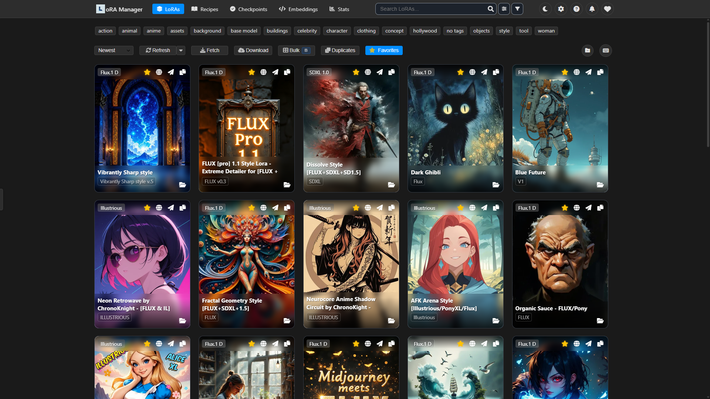

# ComfyUI LoRA Manager

[](https://discord.gg/vcqNrWVFvM)
[](https://github.com/willmiao/ComfyUI-Lora-Manager/releases)
[](https://github.com/willmiao/ComfyUI-Lora-Manager/releases)

**A visual model, recipe, and workflow manager for ComfyUI.**

Organize large model libraries, download and organize new assets, reuse LoRA combinations, manage ComfyUI workflows, and integrate everything with purpose-built ComfyUI nodes. LoRA Manager also runs as a standalone application.

[Getting Started](https://github.com/willmiao/ComfyUI-Lora-Manager/wiki/Getting-Started) ·
[Documentation](https://github.com/willmiao/ComfyUI-Lora-Manager/wiki) ·
[Releases](https://github.com/willmiao/ComfyUI-Lora-Manager/releases) ·
[Browser Extension](https://github.com/willmiao/ComfyUI-Lora-Manager/wiki/LoRA-Manager-Civitai-Extension-(Chrome-Extension))



## Features

### Model library

- Manage LoRAs, checkpoints, diffusion models, and embeddings in one visual interface.
- Optionally manage VAE, Upscaler, Text Encoder, CLIP Vision, and ControlNet files.
- Browse multiple model roots with folder trees, search, filters, tags, previews, and metadata editing.
- Find LoRAs by filename, model name, tags, creator, or trigger words.
- Refresh a whole library, one model root, or one folder; temporarily offline drives remain represented in the library.
- Store metadata sidecars and previews beside models or in a centralized directory.

### Downloads and organization

- Download from CivitAI, Hugging Face, ModelScope, and OpenModelDB for Upscalers.
- Choose default roots and route downloads with ordered base-model or tag rules.
- Organize downloads and existing files with per-type path and filename templates.
- Use the built-in Python downloader or aria2.
- Optionally enrich linked Hugging Face and ModelScope metadata with an LLM provider.

### ComfyUI integration

- Send models and recipes to compatible ComfyUI nodes without manual copy-paste.
- Use LoRA Loader, LoRA Text Loader, Lora Stacker, Prompt, Text, Pool, Randomizer, Cycler, and other specialized nodes.
- Control LoRA strengths and trigger words, use autocomplete, and choose filename or model-name labels on nodes.
- Save generation metadata, override metadata per save stage, and restore prompts and settings from images.
- Expand prompts with wildcard files and generate dynamic output filenames.

### Recipes

- Save, import, export, and share LoRA combinations with weights, prompts, and generation parameters.
- Import recipes from image files or CivitAI image URLs.
- Reconnect missing models and download available ones.
- Save a ComfyUI workflow with a recipe or restore a workflow embedded in an imported recipe.

### Workflow library

- Optionally manage ComfyUI `.json` workflows, workflow archives, and images with embedded workflows.
- Create and update managed workflows from ComfyUI, or open and copy library entries.
- Browse, search, organize, link metadata, and restore downloaded versions.
- Copy Workflow remains available when running LoRA Manager in standalone mode.

## Installation

### ComfyUI Manager — recommended

1. Open **ComfyUI → Manager → Custom Node Manager**.
2. Search for `lora-manager`.
3. Install **ComfyUI LoRA Manager**, restart ComfyUI, and refresh the browser.

### Manual ComfyUI installation

```bash
cd ComfyUI/custom_nodes
git clone https://github.com/willmiao/ComfyUI-Lora-Manager.git
cd ComfyUI-Lora-Manager
pip install -r requirements.txt
```

Restart ComfyUI after installation.

### Portable standalone for Windows

1. Download and extract the [latest portable package](https://github.com/willmiao/ComfyUI-Lora-Manager/releases/latest/download/lora_manager_portable.7z).
2. Run `run.bat`.
3. Open [http://localhost:8188/loras](http://localhost:8188/loras).
4. Configure model folders under **Settings → Model Paths**, then restart the standalone server when prompted.

### Standalone from source

```bash
git clone https://github.com/willmiao/ComfyUI-Lora-Manager.git
cd ComfyUI-Lora-Manager
pip install -r requirements.txt
python standalone.py
```

Use `python standalone.py --host 127.0.0.1 --port 9000` to change the listening address or port.

See [Getting Started](https://github.com/willmiao/ComfyUI-Lora-Manager/wiki/Getting-Started) for model paths, portable settings, and first-run configuration.

## Quick start

1. Click **Launch LoRA Manager** in ComfyUI, or open `http://localhost:8188/loras`.
2. In plugin mode, confirm the model roots inherited from ComfyUI. In standalone mode, configure **Settings → Model Paths**.
3. For CivitAI downloads, add your CivitAI API key in LoRA Manager Settings.
4. Find a model and use **Send to ComfyUI**, or copy its LoRA syntax into a compatible LoRA Manager node.

LoRA tags such as `<lora:name:1.0>` belong in LoRA Manager's own node inputs, not a standard `CLIP Text Encode` prompt.

After changing files outside LoRA Manager, use **Refresh**. **Rebuild Cache** is intended for cache inconsistencies, not routine file discovery.

## Optional browser extension

The LM Civitai Extension adds library status and download actions to Civitai and CivArchive, including model and file downloads, recipe import, Required Components downloads, and workflow downloads.

The extension is optional and includes a 7-day full-feature trial; continued use requires a valid Supporter license. Core LoRA Manager does not require the extension.

- [Install for Chrome and compatible browsers](https://chromewebstore.google.com/detail/lm-civitai-extension/capigligggeijgmocnaflanlbghnamgm)
- [Install the Mozilla-reviewed Firefox extension](https://github.com/willmiao/lm-civitai-extension-firefox/releases/latest/download/extension.xpi)
- [Browser Extension guide](https://github.com/willmiao/ComfyUI-Lora-Manager/wiki/LoRA-Manager-Civitai-Extension-(Chrome-Extension))

## Documentation

The Wiki contains the complete user guides. The in-app **Help → Documentation** tab links to the same canonical pages.

### User guides

- [Getting Started](https://github.com/willmiao/ComfyUI-Lora-Manager/wiki/Getting-Started)
- [Model Library](https://github.com/willmiao/ComfyUI-Lora-Manager/wiki/Model-Library)
- [Downloading and Organizing Models](https://github.com/willmiao/ComfyUI-Lora-Manager/wiki/Downloading-and-Organizing-Models)
- [ComfyUI Integration](https://github.com/willmiao/ComfyUI-Lora-Manager/wiki/ComfyUI-Integration)
- [Recipes](https://github.com/willmiao/ComfyUI-Lora-Manager/wiki/Recipes-Feature-Tutorial-%E2%80%93-ComfyUI-LoRA-Manager)
- [Workflow Library](https://github.com/willmiao/ComfyUI-Lora-Manager/wiki/Workflow-Library)
- [Configuration](https://github.com/willmiao/ComfyUI-Lora-Manager/wiki/Configuration)
- [FAQ](https://github.com/willmiao/ComfyUI-Lora-Manager/wiki/FAQ-(Frequently-Asked-Questions)) and [Troubleshooting](https://github.com/willmiao/ComfyUI-Lora-Manager/wiki/Troubleshooting-Tips)

### Technical references

- [Load Image Metadata node](docs/load-image-metadata.md)
- [Metadata sidecar schema](docs/metadata-json-schema.md)
- [Third-party LoRA node integration](docs/third-party-lora-node-integration.md)
- [Anima LoRA compatibility](docs/anima-lora-compat.md)
- [Development and testing](docs/development.md)

## Contributing

**Feature requests and bug reports are the preferred ways to contribute. They are usually able to move forward more quickly than code pull requests, especially when a change needs design or architecture discussion.**

- For a new capability or workflow improvement, prefer a [feature request](https://github.com/willmiao/ComfyUI-Lora-Manager/issues/new?template=feature_request.md). Describe the problem, your use case, and the outcome you need; implementation proposals are optional.
- For incorrect behavior, use a [bug report](https://github.com/willmiao/ComfyUI-Lora-Manager/issues/new?template=bug_report.md). Include reproduction steps and the environment information from **Settings → About → Copy**.
- Pull requests are still welcome. For non-trivial changes, open an issue first to align on the scope and approach before investing in implementation.
- Search [existing issues](https://github.com/willmiao/ComfyUI-Lora-Manager/issues) before creating a new one, and add useful context to an existing report when possible.
- Documentation feedback and corrections are also welcome through GitHub Issues.

Do not include API keys, access tokens, or other secrets in issues or logs.

## Credits

LoRA Manager has drawn inspiration from:

- [ComfyUI-QwenImageLoraLoader](https://github.com/ussoewwin/ComfyUI-QwenImageLoraLoader) — experimental Nunchaku Qwen-Image LoRA support
- [ComfyUI-SaveImageWithMetaData](https://github.com/nkchocoai/ComfyUI-SaveImageWithMetaData) — image metadata functionality
- [rgthree-comfy](https://github.com/rgthree/rgthree-comfy) — LoRA loader functionality

## Community and support

- [Discord community](https://discord.gg/vcqNrWVFvM)
- [Ko-fi](https://ko-fi.com/pixelpawsai)
- [Patreon](https://patreon.com/PixelPawsAI)
- [WeChat QR code](static/images/wechat-qr.webp)

Thank you to everyone who supports development. See the [Supporter Recognition list](SUPPORTERS.md).
