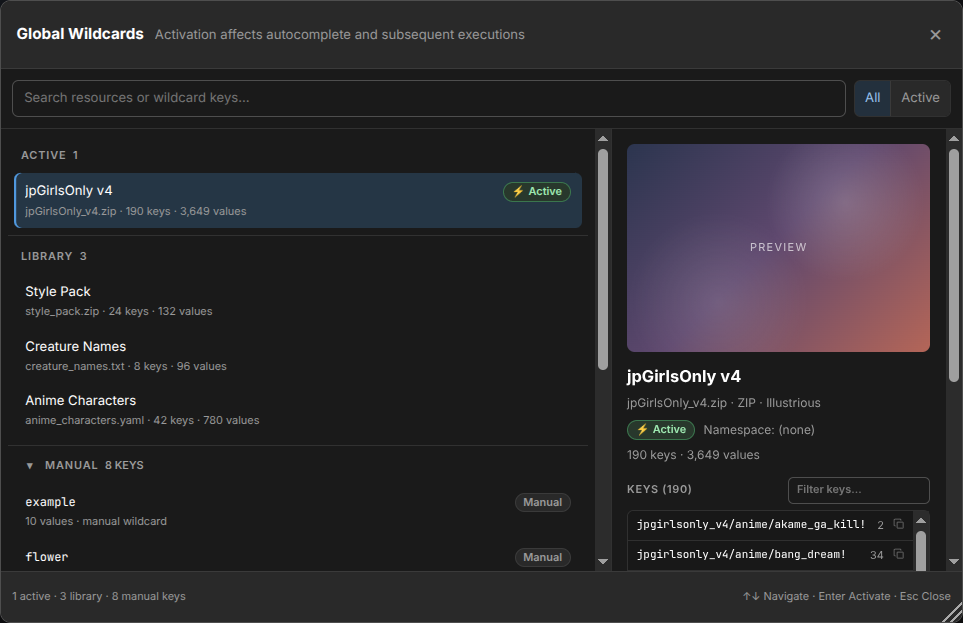
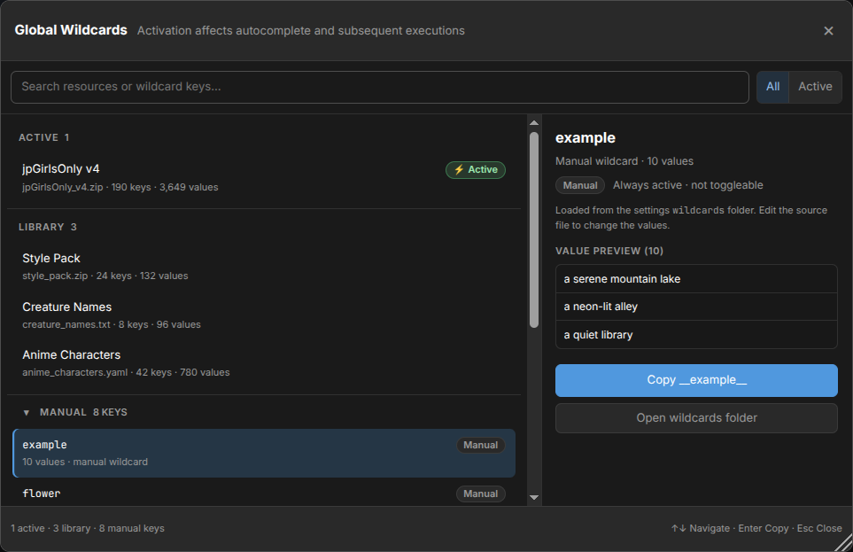
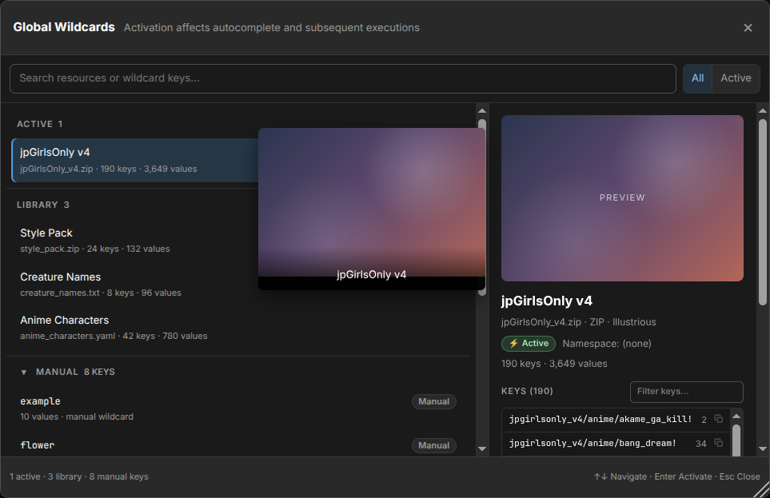

# Global Wildcards Quick Panel — UI/UX Redesign

**Status: implemented.**

The recommended choices from the review are in place: segmented `All | Active`
scope, manual entries as first-class rows with source paths and a three-value
preview, click-to-copy keys, no double-click activation, retained
namespace/alias settings across deactivate → reactivate, and the existing
`Global Wildcards` title. The implementation also uses a compact 110 px preview
and a sticky, two-button action row so the key list and actions stay usable with
long CivitAI names.

The mockup and screenshots below remain the visual reference; small layout
differences (sticky action row, compact preview) are noted in §9.

This document redesigns the ComfyUI **Global Wildcards** quick panel to match
the interaction model of the LoRA quick picker. It supersedes the current
panel's mixed "Active / Library" row list, its row-level Add/On buttons, and
its single combined manual-entries row.



Interactive mockup: [`mockups/wildcard-quick-panel.html`](mockups/wildcard-quick-panel.html)

---

## 1. Why change

The previous panel had three problems:

1. **It did not behave like the other quick pickers.** Rows carried their own
   action button, activation had no badge, and the right column was mostly a key
   dump instead of a coherent overview + action area.
2. **The default scope hid the library.** An Active-only default meant a
   wildcard downloaded or imported in the LoRA Manager did not appear at all
   until it was activated. This is the reported bug.
3. **Manual entries were a single combined row.** An earlier default-view change
   hid that row, and even when visible it could not be searched, selected, or
   inspected key-by-key. Manual entries are a real part of the runtime wildcard
   dictionary, so the redesign makes them first-class rows that are never
   filtered out by the managed-resource scope.

The scanner/cache fix from the previous patch (parsed-index persistence and
backfill) remains a prerequisite: without it the panel can list a resource but
cannot show its keys or value counts.

## 2. Parity with the LoRA quick picker

| LoRA quick picker | Global Wildcards panel |
| --- | --- |
| Rows are LoRA entries only; no row actions | Rows are wildcard resources or manual keys only |
| Right column = preview, name, meta, trigger chips, actions | Right column = preview, name, meta, key list, actions |
| `Added` / `Off` badge in the row head | `Active` badge in the row head; `Manual` badge for manual entries |
| `Filters` / `Recent` toolbar buttons | `All` / `Active` scope control |
| Hover a row to preview the image | Hover a resource row to preview the image |
| `Enter` applies the selected LoRA | `Enter` activates/deactivates the resource, or copies a manual key |
| `Apply & keep open` | Activation never closes the panel |
| Target node selector | Not needed: activation is global to the ComfyUI instance |
| `Full details` action | `Open in manager` action |

The target-node selector is deliberately omitted: wildcard activation is not
tied to a node, so there is no per-workflow target state to choose.

## 3. Panel shell

Keep the existing `createFloatingPanel` shell and dimensions:

- 880 × 570 default, 600 × 380 minimum; resizable, draggable, remembered rect.
- Header: **Global Wildcards**, context line
  `Activation affects autocomplete and subsequent executions`.
- Footer: status on the left, keyboard hints on the right.
- No tabs. A single `Wildcards` surface is enough; the manual section covers
  the second asset kind.

```
┌───────────────────────────────────────────────────────────────────────────┐
│ Global Wildcards   Activation affects autocomplete and subsequent…     ×  │
├───────────────────────────────────────────────────────────────────────────┤
│ [ Search resources or wildcard keys…            ]      [ All | Active ]   │
├──────────────────────────────────┬────────────────────────────────────────┤
│ ACTIVE  1                        │  [ preview image ]                     │
│  jpGirlsOnly v4        ⚡ Active  │  jpGirlsOnly v4                        │
│  jpGirlsOnly_v4.zip · 190 keys   │  jpGirlsOnly_v4.zip · ZIP · Illustrious│
│                                  │  ⚡ Active   Namespace: (none)          │
│ LIBRARY  3                       │  190 keys · 3,649 values               │
│  Style Pack                      │  KEYS (190)              [Filter keys] │
│  style_pack.zip · 24 keys        │  ┌──────────────────────────────────┐  │
│  Creature Names                  │  │ jpgirlsonly_v4/anime/…      2  ⧉ │  │
│  anime_characters.yaml · 42 keys │  │ jpgirlsonly_v4/anime/…     34  ⧉ │  │
│                                  │  └──────────────────────────────────┘  │
│ ▾ MANUAL  8 keys                 │  [ Deactivate ]  [ Open in manager ]   │
│  example               Manual    │  Global activation affects …           │
│  10 values · manual wildcard     │                                        │
├──────────────────────────────────┴────────────────────────────────────────┤
│ 1 active · 3 library · 8 manual keys        ↑↓ Navigate · Enter Activate  │
└───────────────────────────────────────────────────────────────────────────┘
```

## 4. Left column — entries only

### 4.1 Sections

The list is grouped, in this order:

1. **ACTIVE** — managed resources with `active: true`.
2. **LIBRARY** — managed resources with `active: false`.
3. **MANUAL** — keys loaded from `<settings_dir>/wildcards`.

Rules:

- A section renders only when it has at least one visible row; its header shows
  the count.
- `Active` scope hides the **LIBRARY** section only. It keeps **ACTIVE** and
  **MANUAL**, because manual keys are always active in the runtime dictionary.
  The manual header stays `MANUAL · N keys`; the `Manual` badge and the detail
  pane state that these entries are always active and not toggleable.
- Section headers are not focusable and are not list options.
- The **MANUAL** section has a collapse chevron persisted in localStorage
  (`lm:quick-panel:wildcards-manual-collapsed`). It defaults to expanded so
  manual wildcards are never silently hidden.
- Searching automatically expands the manual section.

### 4.2 Managed resource row

```
Name                                   [⚡ Active]   ← badge only when active
jpGirlsOnly_v4.zip · 190 keys · 3,649 values
```

- Two lines: name + subtitle. No thumbnail, no action button, no toggle. This
  matches the LoRA quick picker's name/path rows and keeps actions in the right
  column.
- The activation badge is a green/teal pill with a bolt glyph and the word
  `Active`; it is not clickable. Inactive rows have no badge (the right column
  states `Inactive`), avoiding a wall of grey "Off" chips.
- Subtitle contains file name, format when known, key count, and value count.
  Use `ZIP · 190 keys · 3,649 values` for downloaded artifacts; the file name
  can be the first token when it differs from the display name.
- `data-file-path` on the row for selection, tests, and hover preview.

### 4.3 Manual row

```
example                                           [Manual]
10 values · manual wildcard
```

- Key text uses the monospace stack, like the effective-key rows.
- `Manual` badge is neutral (not green), and the subtitle says
  `N values · manual wildcard`.
- Manual rows are **not** toggleable and never show an `Active` badge: they are
  always part of the runtime dictionary, but they are not managed resources.
- They participate in search and keyboard navigation like any other row.

### 4.4 Scope and search

- Scope control: segmented `[All] [Active]`, default **All**, persisted as
  `lm:quick-panel:wildcards-scope`.
- `All`: active resources, library resources, manual keys.
- `Active`: active resources and manual keys; library hidden.
- Search debounces 180 ms and matches resource name, file name, wildcard keys,
  manual keys, and manual sample values. The search is server-side for
  resources (`/active?search=`) and client-side for manual keys.
- Changing scope keeps a selected row if it is still visible; otherwise selects
  the first visible row, then falls back to the first manual key.
- Status line reflects the current scope:
  - All: `1 active · 3 library · 8 manual keys`
  - Active: `1 active · 8 manual keys`

### 4.5 Empty, loading and error states

| State | Left column | Right column |
| --- | --- | --- |
| Loading | skeleton rows or `Loading wildcards…` | `Loading…` |
| No resources, manual exists | manual section + `No managed wildcard resources yet.` | manual row detail when selected |
| Active scope, none active | manual section (if any) + `No managed wildcards are active.` + `Show all` | empty state |
| Search no match | `No resources or keys match “query”.` | empty state |
| `/active` failed | error message + `Retry` button | empty state |
| Conflict on activate | keep row state + inline error in detail | error + `Resolve in manager` |

## 5. Right column — overview + actions

The right column owns every action. Selection is instant because `/active`
already returns the full lightweight resource; no per-selection request is
needed.

### 5.1 Managed resource (inactive)

- Preview image when `preview_url` exists; otherwise omit it (same as the LoRA
  panel). Video previews use `<video autoplay loop muted playsinline>`.
- Name, then meta: `file · FORMAT · base model`.
- Status: `Inactive` + `Not active`.
- Counts: `190 keys · 3,649 values`.
- Keys list: source keys, each row shows key + value count + copy icon.
  Clicking a key copies `__key__` and shows `Copied __key__` in the footer.
- Actions:
  - Primary **Activate**.
  - Secondary **Open in manager**: reuses the named `lm-lora-manager` tab
    and deep-links to `#model=<file_path>`, where the wildcards page opens
    the same shared model modal a card click uses, with the **Wildcards**
    tab (rendered last) selected.
- If activation returns 409, show the conflicting keys and both owners in an
  inline error; keep the resource inactive; the secondary action becomes
  **Resolve in Manager**.

### 5.2 Managed resource (active)

- Same overview, but:
  - Status pill `⚡ Active`, plus `Namespace: <name>` or `Namespace: (none)`.
  - Single-entry resources also show `Alias: source → effective`.
  - Key rows show the **effective** key (namespace/alias already applied).
- Actions:
  - Primary **Deactivate**.
  - Secondary **Open in manager** (same named-tab deep link).
- Note: `Global activation affects autocomplete and every subsequent execution.`
- Deactivation/reactivation must not silently drop the namespace/alias (see
  open question 4 and the API section).

### 5.3 Manual entry



- No preview image; the name is the key.
- Meta: `Manual wildcard · 10 values`.
- Badge `Manual` + `Always active · not toggleable`.
- Note: `Loaded from the settings wildcards folder. Edit the source file to
  change the values.`
- Value preview: the first three values from the manual dictionary, followed by
  a note that points to the wildcards folder for the rest. Each value is
  selectable text; a `Copy` action copies the complete `__key__` syntax.
- Actions:
  - Primary **Copy __key__**.
  - Secondary **Open folder** (uses
    `POST /api/lm/wildcards/open-location`; the tooltip spells out "Open
    wildcards folder").
- No Activate/Deactivate buttons, by design.

### 5.4 Key list interaction

- A local `Filter keys…` input narrows the visible key rows; it never changes
  the selection or the activation state.
- Keys are full-width rows, not pills: wildcard keys are long and path-like,
  and a row gives them the necessary horizontal space.
- Click a key → copy `__<effective-or-source-key>__`; highlight the row briefly
  and show the copied text in the status bar.
- Render at most 300 keys (same bound as the manager modal). When the resource
  has more, append `Open the manager to browse all N keys`.
- Hovering a key may preview its values in a later iteration; it is not part of
  this review.

### 5.5 Activation feedback

- Activation/deactivation updates the row badge, the section it belongs to, the
  detail status, and the footer status immediately after the API responds.
- The panel stays open. Activation is global, not an apply-to-node action.
- A `lm_wildcards_changed` event from the manager or another surface reloads
  the list while preserving selection and scroll position.
- Runtime conflicts (`runtime_conflicts`) are shown in the footer
  (`· 1 runtime conflict`); conflict repair stays in the manager.

## 6. Hover preview



- Managed resource rows with a real `preview_url`: after a **400 ms** hover,
  show the shared `PreviewTooltip`.
- Use the URL already present in `/active`; no extra request. Resolver:
  `{ previewUrl: resource.preview_url, displayName: resource.model_name }`.
- Position boundary: the results column, so the tooltip flips left instead of
  covering the detail pane and its action buttons (same pattern as the LoRA
  panel).
- Clear on mouse-out, list scroll, scope change, selection change, panel close.
- Manual rows and resources without a preview get no image tooltip. A small
  text tooltip listing 2–3 values for manual keys is an optional enhancement.

## 7. Keyboard and accessibility

| Key | Behavior |
| --- | --- |
| `↑` / `↓` | Move through visible rows (resources + manual keys); scroll into view |
| `Enter` | Resource: Activate / Deactivate. Manual: copy `__key__` |
| `Esc` | Clear search if non-empty, otherwise close the panel |
| `Tab` | Search → scope → list → detail actions |
| `Alt+W` | Toggle the panel (unchanged) |

- Scope buttons use `aria-pressed`.
- The results list uses `role="listbox"`; rows are `role="option"` with
  `aria-selected`. Section headers are plain headings.
- Badges include text (`Active`, `Manual`), not icon-only states.
- Key copy buttons have accessible names (`Copy __key__`), and the copied
  confirmation is announced through the footer status (`aria-live="polite"`).
- No double-click action is planned: a stray double-click must not toggle a
  global activation. Activation is explicit through the primary button or
  `Enter`.

## 8. Data and API changes (implemented)

The `/active` payload now carries the fields below, and activation records keep
their namespace/aliases after deactivation. The optional manual-values endpoint
was not needed for the three-value preview and is left as a future extension.

### `GET /api/lm/wildcards/active`

Add to each managed resource:

| Field | Why |
| --- | --- |
| `wildcard_format` | `ZIP` / `TXT` / `YAML` in the subtitle and meta |
| `base_model` | Optional base-model line in the detail meta |
| `folder` | Optional folder line in the detail |
| `activation_aliases` | Alias summary for active single-entry resources |
| `activated_at` | Optional "activated …" hint in the detail |

Keep `preview_url`, `entries`, `entry_count`, `value_count`, `errors`,
`civitai` as-is.

For manual entries, extend each item from `{key, values_count}` to:

```json
{
  "key": "example",
  "values_count": 10,
  "source_path": "/…/wildcards/example.txt",
  "sample_values": ["a serene mountain lake", "a neon-lit alley", "a quiet library"]
}
```

- `source_path` lets the detail show the file (and makes "Open wildcards
  folder" scoped later).
- `sample_values` (max 3) gives the detail an immediate preview without a
  request. This requires `WildcardService` to expose the source path and a
  bounded sample alongside the existing manual dictionary. If we prefer to keep
  `/active` lean, use the optional endpoint below and omit `sample_values`.

### Optional (not implemented): `GET /api/lm/wildcards/manual/values`

`?key=<normalized key>&offset=0&limit=50` → `{key, values, total, offset}`.

Use it when the right pane needs the full scrollable value list instead of the
sample. It reads the same cached manual dictionary and does not touch disk per
request.

### Activation preservation (implemented)

Deactivation used to delete the activation record, including namespace and
aliases, so a later reactivation from the panel silently lost those choices.
Two options were considered:

1. Keep the record with `active: false` and have `get_active_runtime()` skip
   inactive records; reactivation restores the stored namespace/aliases.
2. Store the last activation settings separately and reuse them on Activate.

Option 1 is implemented: deactivating keeps the record with `active: false`,
the runtime skips it, and the next activation reuses its stored namespace and
aliases (stale aliases whose source keys disappeared are dropped).

`POST /activate` and `POST /deactivate` keep their current request shape.

## 9. Frontend structure

Reuse the LoRA quick-panel patterns rather than inventing a second split-pane
implementation:

- `createFloatingPanel` — shell, rect persistence, Esc handling.
- `PreviewTooltip` + custom `previewUrlResolver` — hover preview.
- `lm-quick__*` CSS — toolbar, split content, rows, detail, actions.
- `WildcardQuickPanel` state:
  ```js
  {
    items: [],              // managed resources from /active
    manual: [],             // manual entries with samples
    scope: "all",           // "all" | "active"
    selected: null,         // {kind:"resource", filePath} | {kind:"manual", key}
    searchQuery: "",
    manualCollapsed: false,
    conflicts: [],
    previewTooltip: null,
    previewTimer: null,
    previewRow: null,
    searchSequence: 0,
  }
  ```
- Render path: `load()` → `render()` (`renderResults()` + `renderDetail()` +
  `renderStatus()`). Activation/deactivation calls the shared endpoint and
  reloads `/active` while preserving the selected resource; a websocket event
  takes the same reload path.
- Remove the current `lm-wildcard-quick-panel__keys`, `__key`, `__manual`, and
  `.lm-quick__row-main` styles; they exist only because the current rows embed
  action buttons.
- New CSS (names mirror the mockup): `.lm-quick__section`,
  `.lm-quick__section-head`, `.lm-quick__section-toggle`, `.lm-wildcard-state`,
  `.lm-wildcard-status`, `.lm-wildcard-counts`, `.lm-wildcard-keys`,
  `.lm-wildcard-key`, `.lm-wildcard-note`, `.lm-wildcard-error`. The wildcard
  detail uses a compact preview and a sticky, horizontal two-button action row
  so the key list stays reachable with long names.
- Badge colors reuse the `.lm-lora-added.is-active` recipe (status green mixed
  with surface), so the two pickers read as one family.

## 10. Implementation summary

1. **Backend fields** — `/active` now includes `wildcard_format`, `base_model`,
   `activation_aliases`, manual `source_path`, and `sample_values`; route and
   service tests cover the payload.
2. **Activation retention** — deactivate keeps a record with `active: false`;
   runtime loading and conflict checks skip it; reactivation restores the
   namespace/aliases.
3. **Panel rewrite** — sectioned list, badges, `All | Active` scope, search,
   right-pane overview, key filter/copy, activation actions, manual detail,
   hover preview, keyboard navigation.
4. **Visual polish** — compact preview and sticky two-button action row keep
   the key list reachable with long names.
5. **Tests** — wildcard service/activation/route tests and the quick-panel JS
   tests were extended; the full suites pass.

## 11. Test plan

### Frontend (`vitest`)

- Default scope is `All`; active + library + manual sections render.
- `Active` hides only the library section; manual entries remain.
- Manual section is present in both scopes and survives a reload of the list.
- Collapse state hides manual rows but keeps the header and count.
- Active resources show the `Active` badge; inactive resources do not.
- Manual rows show `Manual` and have no activation action.
- Search filters resources and manual keys; manual auto-expands.
- Activate/deactivate updates badge, section membership, and footer without
  closing the panel.
- Conflict response keeps the resource inactive and shows the inline error.
- Clicking a key copies `__key__` and updates the status.
- Hover preview only starts for rows with `preview_url` and respects the
  400 ms delay / results-column boundary.

### Backend (`pytest`)

- `/active` includes `wildcard_format`, `activation_aliases`, and manual
  `source_path` / `sample_values`.
- Manual samples are capped and do not change the full runtime dictionary.
- Activation preservation (if implemented) round-trips namespace/aliases across
  deactivate → activate.
- Existing wildcard parser/scanner/activation tests still pass.

### Manual checklist

- Open `Alt+W` with the mockup's data shape (one active, several inactive, 8
  manual keys).
- Confirm the manual section is visible on first open.
- Confirm `All`/`Active` changes only the library rows.
- Hover a preview row; confirm the preview stays over the list column.
- Activate an inactive resource; confirm the row moves to ACTIVE with a badge.
- Deactivate; confirm it moves back and the panel stays open.
- Resize the panel to 600 × 380; confirm the list and detail still scroll and
  actions remain reachable.

## 12. Decisions after review

1. **Scope control**: segmented `All | Active`, default `All`.
2. **Manual section**: bottom section, always present, user-collapsible.
3. **Manual values**: three `sample_values` in `/active`; the full-list endpoint
   remains optional.
4. **Activation preservation**: keep namespace/aliases across deactivate →
   reactivate.
5. **Key interaction**: click a key to copy `__key__` immediately.
6. **Double-click**: no action; activation is explicit via the button or Enter.
7. **Panel title**: keep `Global Wildcards`.
8. **Manual in Active scope**: keep manual keys visible as always-active.
